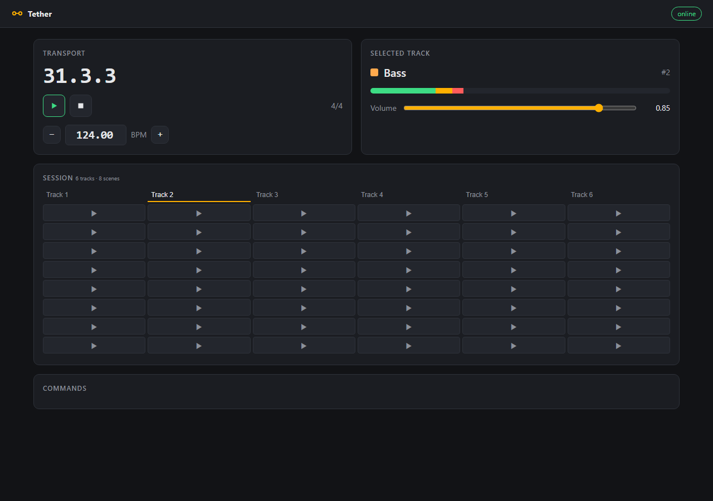

# Tether

A Max for Live device that links an Ableton Live Set to a small Node server over WebSocket.

Drop it on a track and it streams the tempo, play state, song position, time signature and the
selected track's name, colour, volume and meter. The server can send back a few commands
(play, stop, tempo, volume, select a track, fire a clip). A browser dashboard sits on top so
you can watch and control the Set from another machine.



## Install

Copy `Tether.amxd` and `tether-bridge.js` from the `Tether/` folder to the same place (your
User Library is fine) and drag the device onto a track.

## Run the server

```bash
npm ci
npm run server    # prints a device URL, a token and a dashboard link
npm run sim       # optional: a fake Live Set for when Live isn't open
```

Open the dashboard link, paste the server URL and token into the device, press Enter in each
field and click Connect.

The server only listens on localhost by default. Set `HOST=0.0.0.0` to allow other machines
and `TETHER_TOKEN` for a fixed token. For anything beyond your own network use `wss://`: set
`TETHER_TLS_CERT` and `TETHER_TLS_KEY`, or put the server behind a reverse proxy. For a
self-signed certificate, put the CA file next to the device as `tether-ca.pem`.

The token is saved in the `.als` file like any other device setting, so give each
collaborator their own.

## Develop

```bash
npm test          # unit and integration tests
npm run build     # regenerate Tether/Tether.amxd and Tether/tether-bridge.js
```

The patch is generated from `device/patcher.mjs` and packed by `tools/amxd.mjs`. The Node side
is bundled into one file with esbuild.

## Licence

MIT
